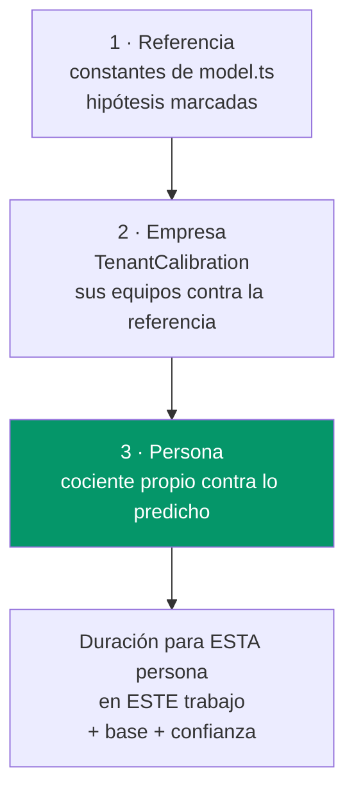
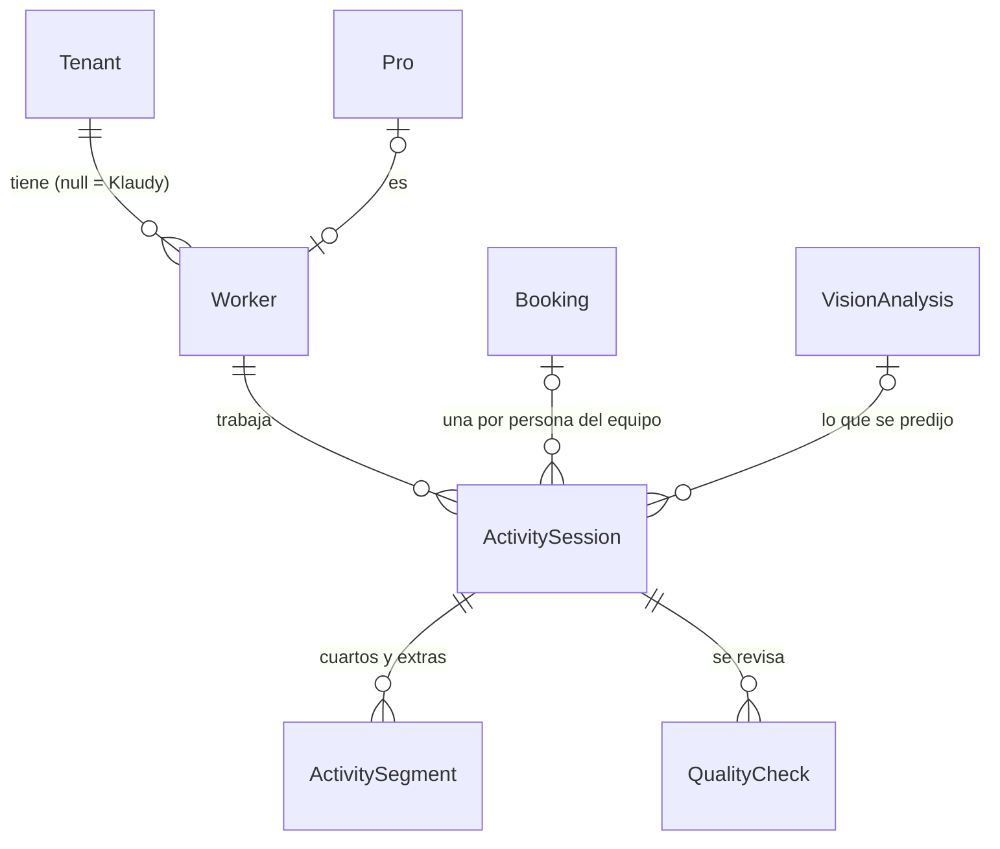
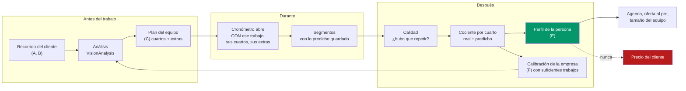

# Aprender cómo trabaja cada persona

**Propuesta de diseño. Nada de esto está construido todavía** salvo lo que la
sección 1 marca como existente. En español, como `ARQUITECTURA.md`, para el
fundador.

La pregunta: ¿cómo hace la app para aprender cuánto tarda **cada** limpiador,
y luego usar ese número?

La respuesta corta: no se aprende "cuánto tarda Luis en un horno". Se aprende
**cuánto tarda Luis comparado con lo que el motor predijo para ese mismo
cuarto**. Ese cociente ya trae dentro la grasa, el desorden y el tamaño, porque
la predicción los contaba. Es la diferencia entre necesitar meses de datos y
necesitar dos trabajos.

---

## 1. Lo que ya existe

Más de lo que parece. Casi todo el "módulo D" (medir tiempos) está hecho.

| Pieza | Dónde | Qué hace hoy |
|---|---|---|
| Cronómetro de campo | `/pilot/tiempo`, `components/pilot/JobTimer.tsx` | *Llegué* → cuarto por cuarto → *Parar* → *Me voy*. Un toque por cuarto, con guantes. |
| Bot de voz | Telegram, `lib/activity/commands.ts` | Lo mismo hablando: "cocina", "baño", "fin del trabajo". |
| Registro | `ActivitySession` / `ActivitySegment` (Prisma) | Una sesión por persona y trabajo; un segmento por cuarto, con detalle libre ("el horno"). |
| Identidad | `app/api/activity/route.ts` | Quién registra sale de la sesión iniciada, **nunca** del cuerpo de la petición: nadie puede escribir tiempos a nombre de otro. |
| Puerta a puerta vs. manos en el cuarto | `sessionSpan()`, `overheadSummary()` | La constante que falta para calibrar, con mediana. |
| Tiempos por tipo de cuarto | `roomTimings()` | Mediana, mínimo y máximo reales. |
| **Factor personal** | `personalFactor()` | Lo rápido que va una persona frente a todos, cuarto a cuarto. Pide 8 cuartos como mínimo. **Escrito y probado, pero ninguna pantalla lo usa.** |
| Contexto de cansancio | `TrainingSample.jobSequence`, `hoursWorkedToday`, `fatigueBuckets()` | Si el cuarto trabajo del día va más lento que el primero. |
| Calidad por fotos | `TrainingSample.qualityScore` | Antes contra después. |
| Calibración por empresa | `TenantCalibration` | Un factor global y bases por cuarto, para cada empresa cliente. |
| Constantes marcadas | `lib/vision/model.ts` | Cada número dice si es `MEASURED` o hipótesis. |
| El orden del trabajo | `lib/vision/plan.ts` | El plan del equipo, cuarto por cuarto, con los extras que el cliente pagó. |

## 2. Lo que falta: cuatro huecos

1. **La sesión no sabe de qué trabajo es.** `ActivitySession` no apunta ni a la
   reserva ni a la cotización. Sin eso no hay "predicho contra real" del mismo
   cuarto, que es justo lo que hay que aprender.
2. **La persona es un correo o un chat de Telegram**, no alguien. La misma
   limpiadora en la web y en Telegram son dos personas distintas para la app.
3. **No hay calidad en el cronómetro.** Un cuarto rápido que hubo que repetir
   cuenta hoy como rápido.
4. **No se distingue un dato real de uno de prueba.** Hoy todo lo que se
   registra es "real".

---

## 3. Qué tomo de la propuesta de ChatGPT y qué cambio

**Tiene razón en lo importante**, y todo eso entra tal cual:

- Separar estimación inicial de tiempo aprendido, y decir siempre cuál es cuál.
- Un perfil por persona, nunca un promedio para todos.
- Medianas, no medias. (El código ya lo hace por esa misma razón.)
- Un nivel de confianza en cada estimación.
- No usar la edad. Ni la edad ni nada que no sea trabajo observado.
- Rápido y mal no es productivo.
- Datos sintéticos solo para pruebas, marcados.
- El activo es la base de datos, no el modelo. (`ARQUITECTURA.md` §5 dice lo
  mismo: *"esta tabla es tuya"*.)

**Cambio cinco cosas:**

**a) No una tabla de tiempos por persona y por tarea: un cociente contra la
predicción.** Una tabla "Luis × horno × grasa alta × cansado" tiene cientos de
casillas, y con el volumen de una empresa pequeña casi todas estarían vacías un
año. En cambio, si el motor predijo 40 min para *esa* cocina y Luis tardó 46,
Luis va a 1,15 en cocinas. La grasa ya está dentro del 40. Con 8 cuartos hay un
primer número; con 30, uno fiable.

**b) El cronómetro se queda en cuartos; las tareas solo donde importan.** Pedir
ocho toques por cocina (encimera, fregadero, estufa…) con guantes es la forma
más segura de que dejen de tocar. Los cuartos siempre; las tareas solo para los
**extras que el cliente pagó** ("el horno por dentro", "la nevera por dentro").
Ahí está la duda que cuesta dinero: esos minutos extra se le cobran al cliente
y hoy son hipótesis.

**c) El video no sirve para medir tiempos.** La analogía de los robots tiene
una trampa: un robot aprende de demostraciones porque necesita aprender
**movimientos**. Nosotros necesitamos **duraciones**, y un toque en la pantalla
da el inicio y el final exactos por cero dólares. El video cuesta dinero,
necesita el permiso del trabajador **y** el del dueño de la casa, y da un
inicio y un final menos exactos que el toque. Si algún día sirve, será para
otra cosa: enseñar a alguien nuevo cómo limpia un horno la persona más rápida.

**d) El cansancio se calcula; preguntarlo es opcional.** "Tercer trabajo del
día, 5 horas ya trabajadas" sale solo de los registros, es objetivo y ya está
en el esquema. Preguntar el cansancio declarado antes y después, y el esfuerzo
percibido, son tres preguntas por trabajo que se contestan peor cada semana.
Entra como **una** pregunta opcional al tocar *Llegué*, y no se usa para
estimar hasta que los datos demuestren que cambia algo.

**e) El tiempo de una persona nunca cambia el precio del cliente.** Ver la
sección 6. La propuesta no lo dice, y es la regla más importante de todo esto.

---

## 4. La idea central, con números

*Ejemplo ilustrativo, no son tiempos reales.*

| Cuarto | El motor predijo | Luis tardó | Cociente |
|---|---|---|---|
| Cocina con grasa | 40 min | 46 min | 1,15 |
| Cocina casi limpia | 22 min | 25 min | 1,14 |
| Baño | 25 min | 24 min | 0,96 |
| Baño con moho | 38 min | 35 min | 0,92 |

Una cocina tardó el doble que la otra, y las dos dicen lo mismo de Luis: en
cocinas va un 15% por encima de lo previsto. En baños, un 5% por debajo.
**Eso** es aprender a la persona, y no hizo falta separar la grasa a mano.

Tres consecuencias:

- **Las fortalezas salen solas**: Luis es más fuerte en baños que en cocinas,
  medido contra su propia media. Es lo que pediste para que cada uno vea dónde
  rinde más y lo pueda negociar.
- **Mejorar se nota**: se usan los últimos 40 cuartos de cada tipo, no toda la
  historia. Si Luis mejora en cocinas, su número baja.
- **Si el motor se equivoca, se equivoca para todos igual**, y el cociente de
  cada persona sigue siendo justo. El error del motor se corrige aparte, a nivel
  de empresa (sección 5).

---

## 5. Tres capas, y la confianza de cada una



La capa de la persona arranca pareciéndose a la empresa y se va pareciendo a sí
misma:

```
factor = (n × mediana de la persona + 8 × factor de la empresa) / (n + 8)
```

Con 0 cuartos medidos, es la empresa. Con 8, mitad y mitad. Con 40, 83% ella
misma. Así nadie recibe un número extremo por un día raro, que es lo mismo que
`personalFactor()` ya evita con su mínimo de 8.

Cada estimación sale con su etiqueta, y la pantalla la muestra:

| Confianza | Cuándo | Cómo se dice |
|---|---|---|
| **Provisional** | La persona no tiene cuartos medidos | "Estimación inicial, todavía no aprendida" |
| **Baja** | Menos de 8 cuartos | "Pocos datos" |
| **Media** | 8–29 cuartos | "Historial en crecimiento" |
| **Alta** | 30 o más, y poca dispersión (±25%) | "Fiable" |

Los cortes (8, 30, 25%) son **hipótesis**, como las constantes. Se revisan con
datos.

---

## 6. Para qué se usa, y para qué no

**Se usa para:**

- **Agendar**: bloquear 3 h 10 para Luis y 2 h 40 para Ana en el mismo
  apartamento.
- **La oferta al limpiador**: hoy `Booking.estimatedMinutes` se le enseña al
  profesional antes de aceptar. Pasaría a decir "para ti, unas 3 h 10 (confianza
  media, 14 cuartos medidos)".
- **Decidir cuántas personas mandar** y a quién.
- **El margen interno** de cada trabajo.
- **Que cada persona vea sus fortalezas**, primero ella.

**Nunca se usa para:**

- **El precio del cliente.** El cliente paga por su casa, no por quién le toque.
  Si Luis va más lento, el cliente no paga más; si Ana va más rápida, la empresa
  gana margen (o le paga mejor a Ana). Además, cuando se cotiza todavía no hay
  nadie asignado. Es la misma regla que ya existe al revés: *el precio sale de
  lo que la cámara vio, nunca de quién es el cliente*. Tampoco de quién limpia.
- **`/q/[slug]` ni la API v1.** No salen tiempos personales por ninguna puerta
  pública.
- **Castigar o despedir de forma automática.** Un número sin contexto no decide
  nada sobre una persona (sección 9).

---

## 7. Entidades y relaciones

Reutiliza las tablas que existen en vez de crear un sistema paralelo. Lo nuevo
está marcado.



### `Worker` — NUEVA

La persona, una sola vez, venga de la web o de Telegram.

| Campo | Para qué |
|---|---|
| `id` | |
| `tenantId?` | De qué empresa es. Vacío = Klaudy. **Los tiempos de los equipos de una empresa son de esa empresa**: nunca se mezclan con los de otra ni se agregan entre empresas, igual que sus clientes (`TenantLead`). |
| `proId?` (único) | Enlace al `Pro` del marketplace, si lo es. |
| `telegramChatId?` (único) | Para que el bot de voz escriba a la misma persona. |
| `name`, `active`, `createdAt` | |

No guarda edad, género, nacionalidad, salud ni nada parecido. No es un olvido.

### `ActivitySession` — se amplía

| Campo nuevo | Para qué |
|---|---|
| `workerId` | Quién. `loggedBy` se queda por compatibilidad. |
| `bookingId?` | De qué reserva. |
| `analysisId?` | Qué predijo el motor para esa casa: el "predicho" del cociente. |
| `source` | `field` (trabajo real) · `practice` (día de medición, real pero sin cliente) · `test` (pruebas automáticas). **`test` no entra en ningún cálculo, nunca**, y el filtro vive en un solo sitio. |
| `crewSize` | Cuántas personas había en la casa. |
| `arrivalFeeling?` | La pregunta opcional al tocar *Llegué*: bien · normal · cansado. |

Lo que **no** se pregunta porque se calcula: trabajo número N del día, horas ya
trabajadas, hora de inicio.

### `ActivitySegment` — se amplía

| Campo nuevo | Para qué |
|---|---|
| `roomKey?` | **Qué** cuarto del recorrido ("baño 2"), no solo qué tipo. Así se compara con la predicción de ese cuarto. |
| `taskKey?`, `depth?` | Solo para extras: `oven` + `deep` = "el horno por dentro". Sale del catálogo de objetos, no de texto libre. |
| `predictedMinutes?` | Lo que el motor dijo para ese cuarto o extra, **guardado en ese momento**. Si mañana cambian las constantes, el cociente de hoy sigue significando lo mismo. |
| `together` | Dos personas en el mismo cuarto a la vez. Esos cuartos cuentan para la empresa, no para el ritmo de cada una. |
| `excluded`, `excludedReason` | "Dejé el reloj corriendo en la comida." **Se marca, no se borra**: un registro que se puede editar sin rastro no vale como verdad. |

### `QualityCheck` — NUEVA

| Campo | Para qué |
|---|---|
| `sessionId`, `roomKey?` | Qué se revisó. |
| `result` | `ok` · `redo` (hubo que repetir). |
| `by` | `worker` · `supervisor` · `customer`. |
| `note?`, `createdAt` | |

Se alimenta de tres sitios: al tocar *Me voy* ("¿hubo que repetir algo?"), de
una revisión de supervisor cuando la haya, y de la reseña o la queja del
cliente (`Review` ya existe).

**Un cuarto con `redo` no cuenta para el ritmo de nadie.** Rápido y mal no
cuenta como rápido.

### El perfil — calculado, no guardado

Al principio el perfil se calcula al leerlo, como `overheadSummary()` hoy. Los
datos son pocos y así nunca está desactualizado. Si un día pesa, se guarda en
caché, pero **los registros son la verdad y el perfil siempre se puede
recalcular desde ellos**.

```ts
// Lo que devuelve, por persona y tipo de cuarto (o extra):
interface PaceEstimate {
  factor: number;           // 1,15 = 15% más que lo predicho
  samples: number;          // cuartos que cuentan
  spread: number;           // dispersión, para la confianza
  confidence: 'provisional' | 'low' | 'medium' | 'high';
}

// Y la duración de un trabajo para alguien:
interface DurationEstimate {
  minutes: number;
  basis: 'reference' | 'company' | 'worker';  // de qué capa sale
  confidence: 'provisional' | 'low' | 'medium' | 'high';
  samples: number;
}
```

---

## 8. Flujo de información



Los seis módulos de la propuesta ya tienen casa:

| Módulo | Dónde vive |
|---|---|
| A · Reconocimiento | `lib/vision/analyzer.ts`, `scout.ts` — existe |
| B · Conversación con el cliente | `lib/capture/conversation.ts`, `GuidedCapture.tsx` — existe |
| C · Tareas | `lib/vision/plan.ts`, `upsell.ts` — existe; pasa a ser la lista del cronómetro |
| D · Tiempos | `lib/activity/store.ts`, `JobTimer.tsx`, Telegram — existe; se amplía |
| E · Aprendizaje por persona | `lib/workers/pace.ts` — **nuevo**; se lleva `personalFactor()` |
| F · Estimación | `lib/vision/estimate.ts`, `model.ts`, `TenantCalibration` — existe; se añade "duración para esta persona", **separada del precio** |

Se pasan datos con tipos definidos (`PaceEstimate`, `DurationEstimate`), nunca
con números metidos en un prompt. El modelo de visión sigue sin calcular
tiempos ni precios.

---

## 9. Las personas que se miden

Medir a alguien mientras trabaja es delicado, y una herramienta que el equipo
siente en su contra **se sabotea**: se toca tarde, se olvida, se dejan de medir
los días malos. Un dato honesto solo sale de alguien que gana algo dándolo.

- **Cada persona ve sus datos primero**, antes que nadie más.
- **La pregunta del cansancio es opcional** y no se usa para pagar ni para
  sancionar.
- **Nada decide sola sobre una persona.** Un número bajo es una conversación,
  no una consecuencia.
- **Sin video por defecto.** Si algún día lo hay: permiso del trabajador **y**
  del cliente, borrado por defecto, y las tres puertas de
  `VISION_ARCHIVE_MODE` (que hoy está apagado a propósito).

**Tres avisos legales** (no es consejo legal; un abogado antes de construir):

- **Nueva York** obliga desde 2022 (Civil Rights Law §52-c) a avisar por
  escrito, al contratar, cuando una empresa monitorea electrónicamente a sus
  empleados. Un cronómetro que toca el propio trabajador probablemente no lo
  es; video o ubicación se le parecen mucho más.
- **La ciudad de Nueva York** (Local Law 144) exige una auditoría de sesgo a
  cualquier herramienta automática que ayude a decidir **contrataciones o
  ascensos**. Si el ritmo medido llega a usarse para eso, entra.
- **Si los limpiadores son contratistas 1099** (los pagos por Stripe Connect lo
  son), que la empresa les mida cada tarea y les diga cómo trabajar es de las
  cosas que se miran para decidir si en realidad son empleados. Para ellos la
  herramienta tiene que ser **suya**: opcional, y que les sirva para negociar.

---

## 10. Cuántos datos hacen falta, de verdad

Un apartamento típico de Klaudy tiene unos 5 cuartos.

| Para tener… | Hace falta | Para una persona son |
|---|---|---|
| Un primer ritmo general (confianza media) | ~8 cuartos | ~2 trabajos |
| Un ritmo general fiable | ~30 cuartos | ~6 trabajos |
| Su ritmo en cocinas, aparte | ~8 cocinas | ~8 trabajos |
| Cuánto tarda **el horno por dentro** | ~8 hornos | ~40 trabajos, si 1 de cada 5 clientes lo pide |
| Tocar las constantes del motor | puerta a puerta en ~20 trabajos | toda la empresa junta |

Lo último es lo que manda `CLAUDE.md`: no se recalibran las constantes con
pocas muestras. El panel ya avisa por debajo de 5 trabajos; 20 es mi
recomendación, y también es una hipótesis.

Hoy hay **un** trabajo medido.

---

## 11. Fases

**Fase 1 — Medir bien.** Sin esto lo demás aprende de basura.

1. `Worker`: una persona, venga de la web o de Telegram.
2. El cronómetro se abre **desde el trabajo**: enseña los cuartos que salieron
   en el recorrido ("Baño 1", "Baño 2") y los extras pagados como botones, y
   guarda lo predicho en cada segmento.
3. `source` en cada sesión; las pruebas automáticas escriben `test`.
4. "Esto está mal" en un segmento: se marca, no se borra.
5. Al tocar *Me voy*: "¿hubo que repetir algo?". Al tocar *Llegué*, opcional:
   "¿cómo llegas hoy?".
6. En `/admin/timings`, una tabla por persona con su confianza
   (`personalFactor()` ya existe; nadie lo enseña).

**Fase 2 — El perfil.** Cuando haya ~2 trabajos por persona.

- `PaceEstimate` con la mezcla de la sección 5.
- Pantalla **"Mis tiempos"** para el limpiador: sus fortalezas por tipo de
  cuarto, contra su propia media.
- La oferta al profesional dice cuánto le va a llevar **a él**.

**Fase 3 — Calibrar la empresa.** Cuando haya puerta a puerta en ~20 trabajos.

- Con los cocientes de todos, corregir `TenantCalibration` y, con mucho
  cuidado, las constantes de `model.ts`.

**Fase 4 — Video, quizá nunca.** Para enseñar a trabajar, no para medir.

---

## 12. Lo que tienes que decidir tú

1. **¿Tus limpiadores son empleados o contratistas 1099?** Cambia cómo se
   presenta la herramienta y lo que la empresa puede pedirles.
2. **¿Quién revisa la calidad?** Si no hay supervisor, el primer `QualityCheck`
   es el propio limpiador y la reseña del cliente; vale, pero hay que saberlo.
3. **¿Las empresas que compran el motor tendrán esto?** El diseño ya lo
   permite (`Worker.tenantId`), pero es una decisión de producto: venderles
   "aprende el ritmo de tu equipo" es un argumento fuerte, y también una
   responsabilidad sobre los datos de sus empleados.
