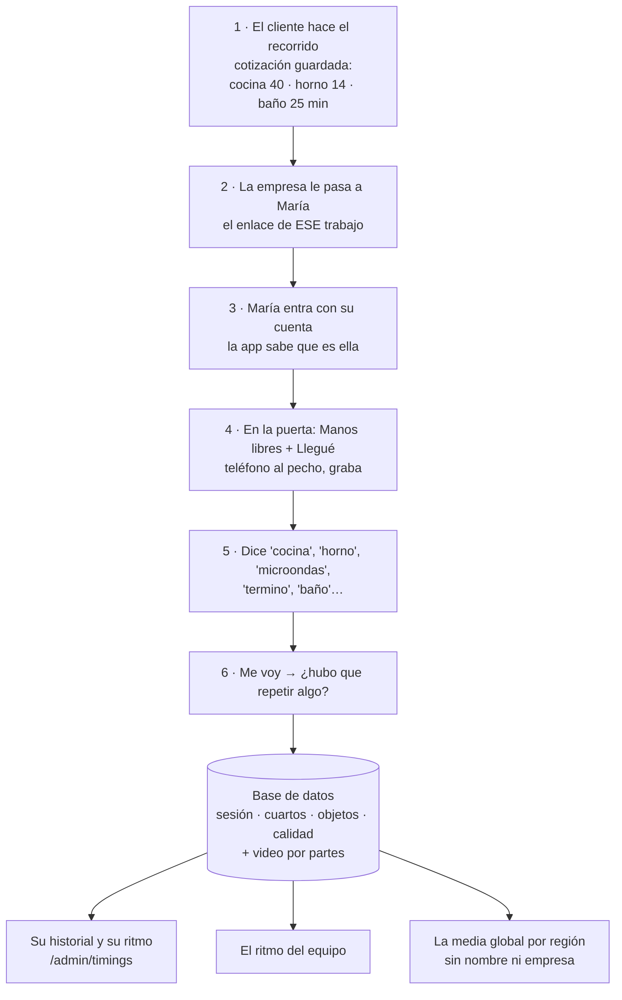
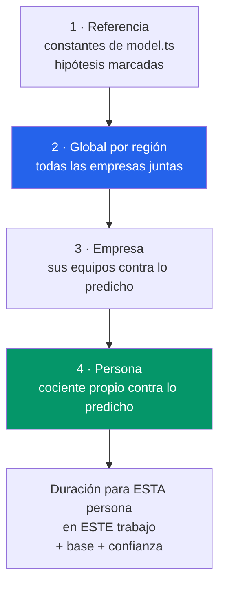
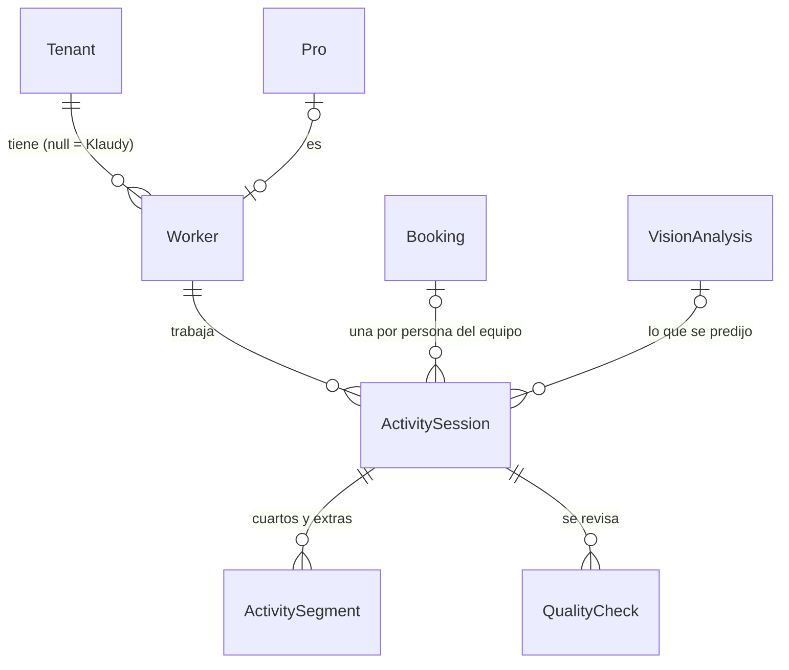
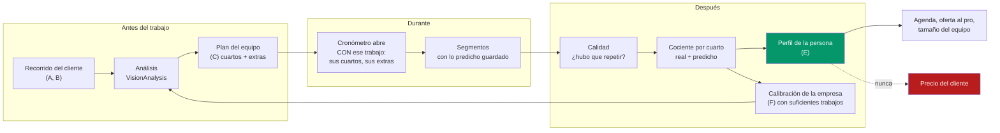

# Aprender cómo trabaja cada persona

Diseño y estado de lo construido (la fase 1 y el modo manos libres, 24–25 nov
2026; ver §11). En español, como `ARQUITECTURA.md`, para el fundador.

La pregunta: ¿cómo hace la app para aprender cuánto tarda **cada** limpiador,
y luego usar ese número?

La respuesta corta: no se aprende "cuánto tarda Luis en un horno". Se aprende
**cuánto tarda Luis comparado con lo que el motor predijo para ese mismo
cuarto**. Ese cociente ya trae dentro la grasa, el desorden y el tamaño, porque
la predicción los contaba. Es la diferencia entre necesitar meses de datos y
necesitar dos trabajos.

---

## 0. Un día de María, de principio a fin

**No hay otra aplicación.** El teléfono de María abre la misma web, con su
cuenta, en otra pantalla (`/pilot/tiempo`). Todo cae en la misma base de datos
que las cotizaciones: no hay nada que "enviar a la app maestra" ni que
sincronizar, porque es la misma.



**Paso a paso, con números inventados:**

1. **Antes.** El cliente hizo el recorrido. Quedó guardada la cotización con
   sus cuartos y lo que el motor predijo para cada uno: cocina 40 min, el
   horno por dentro 14, baño 25.
2. **La empresa le da el trabajo a María** con el enlace de ese trabajo. Hoy,
   el enlace "Open" en `/admin/vision`; más adelante, dentro de la oferta.
3. **María abre el enlace con su cuenta.** La app crea su ficha (`Worker`) la
   primera vez; desde entonces, todo lo que mida es de ella, entre por la web
   o por Telegram.
4. **En la puerta activa *Manos libres* y toca *Llegué*.** Se pone el teléfono
   en el pecho o la cabeza. Desde ahí graba, y la hora de llegada queda
   apuntada: es el principio del puerta a puerta.
5. **Trabaja diciendo lo que empieza.** "Cocina" → empieza la cocina. "Horno"
   → empieza el horno, dentro de la cocina, con sus 14 min previstos
   guardados al lado. "Termino" → para el reloj (lleva cosas al coche). Cada
   palabra suena con un pitido para que sepa que se oyó.
6. **"Me voy"**: la pantalla pregunta si hubo que repetir algo. Contesta y se
   cierra el trabajo. El video termina de subirse (o se queda en el teléfono
   si no hay almacenamiento configurado, con un botón para guardarlo).

**Lo que queda guardado de esas 2 horas:**

| Qué | Ejemplo |
|---|---|
| Puerta a puerta | 2 h 00 |
| Cocina (con todo lo de dentro) | 38 min, el motor dijo 40 → **0,95** |
| Horno por dentro | 12 min, el motor dijo 14 → **0,86** |
| Microondas por fuera | 2 min, el motor dijo 1 → **2,0** |
| Baño | 30 min, el motor dijo 25 → **1,20** |
| Lo demás (traslado, montaje, recogida) | 2 h − la suma de los cuartos |
| Calidad | "no hubo que repetir nada" |
| Video | una parte cada 30 s (240 en 2 horas), con la hora en que empezó |

**Lo que se calcula con eso** (al momento de mirar, sin procesos aparte):

- **El historial de María** son todos esos cocientes, trabajo tras trabajo.
- **Su "promedio"** es la **mediana** de sus últimos 40 cuartos, no la media,
  para que un día raro no la mueva. Hasta 8 cuartos se mezcla con la del
  equipo; a partir de ahí es cada vez más ella. Por eso el "Unas 2 h 48 para
  ti" de la pantalla dice *pocos datos todavía* al principio.
- **Sus fuertes y flojos**: en qué tipo de cuarto va mejor que su propia media.
- **El equipo** es la mediana de todos; **lo global** junta a todas las
  empresas, sin nombres, por región.

**Para qué sirve el video si los tiempos ya salen de la voz:** cada palabra
de María deja una marca de tiempo, así que se sabe en qué segundo del video
empieza y acaba el horno. Eso permite, en el paso 2, cortar el video por
objeto, sacar el antes y el después de cada uno, y que la IA aprenda a
reconocer las tareas sola; y deja un conjunto de video etiquetado que vale por
sí mismo.

---

## 1. Lo que ya existe

Más de lo que parece. Casi todo el "módulo D" (medir tiempos) está hecho.

| Pieza | Dónde | Qué hace hoy |
|---|---|---|
| Cronómetro de campo | `/pilot/tiempo`, `components/pilot/JobTimer.tsx` | *Llegué* → cuarto por cuarto → *Parar* → *Me voy*. Un toque por cuarto, con guantes. |
| Bot de voz | Telegram, `lib/activity/commands.ts` | Lo mismo hablando: "cocina", "baño", "fin del trabajo". |
| Registro | `ActivitySession` / `ActivitySegment` (Prisma) | Una sesión por persona y trabajo; un segmento por cuarto, con detalle libre ("el horno"). |
| Identidad | `app/api/activity/route.ts` | Quién registra sale de la sesión iniciada, **nunca** del cuerpo de la petición: nadie puede escribir tiempos a nombre de otro. |
| Puerta a puerta vs. manos en el cuarto | `sessionSpan()`, `overheadSummary()` | La constante que falta para calibrar, con mediana. |
| Tiempos por tipo de cuarto | `roomTimings()` | Mediana, mínimo y máximo reales. |
| **Factor personal** | `personalFactor()` | Lo rápido que va una persona frente a todos, cuarto a cuarto. Pide 8 cuartos como mínimo. **Escrito y probado, pero ninguna pantalla lo usa.** |
| Contexto de cansancio | `TrainingSample.jobSequence`, `hoursWorkedToday`, `fatigueBuckets()` | Si el cuarto trabajo del día va más lento que el primero. |
| Calidad por fotos | `TrainingSample.qualityScore` | Antes contra después. |
| Calibración por empresa | `TenantCalibration` | Un factor global y bases por cuarto, para cada empresa cliente. |
| Constantes marcadas | `lib/vision/model.ts` | Cada número dice si es `MEASURED` o hipótesis. |
| El orden del trabajo | `lib/vision/plan.ts` | El plan del equipo, cuarto por cuarto, con los extras que el cliente pagó. |

## 2. Lo que falta: cuatro huecos

1. **La sesión no sabe de qué trabajo es.** `ActivitySession` no apunta ni a la
   reserva ni a la cotización. Sin eso no hay "predicho contra real" del mismo
   cuarto, que es justo lo que hay que aprender.
2. **La persona es un correo o un chat de Telegram**, no alguien. La misma
   limpiadora en la web y en Telegram son dos personas distintas para la app.
3. **No hay calidad en el cronómetro.** Un cuarto rápido que hubo que repetir
   cuenta hoy como rápido.
4. **No se distingue un dato real de uno de prueba.** Hoy todo lo que se
   registra es "real".

---

## 3. Qué tomo de la propuesta de ChatGPT y qué cambio

**Tiene razón en lo importante**, y todo eso entra tal cual:

- Separar estimación inicial de tiempo aprendido, y decir siempre cuál es cuál.
- Un perfil por persona, nunca un promedio para todos.
- Medianas, no medias. (El código ya lo hace por esa misma razón.)
- Un nivel de confianza en cada estimación.
- No usar la edad. Ni la edad ni nada que no sea trabajo observado.
- Rápido y mal no es productivo.
- Datos sintéticos solo para pruebas, marcados.
- El activo es la base de datos, no el modelo. (`ARQUITECTURA.md` §5 dice lo
  mismo: *"esta tabla es tuya"*.)

**Cambio cinco cosas:**

**a) No una tabla de tiempos por persona y por tarea: un cociente contra la
predicción.** Una tabla "Luis × horno × grasa alta × cansado" tiene cientos de
casillas, y con el volumen de una empresa pequeña casi todas estarían vacías un
año. En cambio, si el motor predijo 40 min para *esa* cocina y Luis tardó 46,
Luis va a 1,15 en cocinas. La grasa ya está dentro del 40. Con 8 cuartos hay un
primer número; con 30, uno fiable.

**b) El cronómetro se queda en cuartos; las tareas solo donde importan.** Pedir
ocho toques por cocina (encimera, fregadero, estufa…) con guantes es la forma
más segura de que dejen de tocar. Los cuartos siempre; las tareas solo para los
**extras que el cliente pagó** ("el horno por dentro", "la nevera por dentro").
Ahí está la duda que cuesta dinero: esos minutos extra se le cobran al cliente
y hoy son hipótesis.

**c) El video no sirve para medir tiempos.** La analogía de los robots tiene
una trampa: un robot aprende de demostraciones porque necesita aprender
**movimientos**. Nosotros necesitamos **duraciones**, y un toque en la pantalla
da el inicio y el final exactos por cero dólares. El video cuesta dinero,
necesita el permiso del trabajador **y** el del dueño de la casa, y da un
inicio y un final menos exactos que el toque. Si algún día sirve, será para
otra cosa: enseñar a alguien nuevo cómo limpia un horno la persona más rápida.

**d) El cansancio se calcula; preguntarlo es opcional.** "Tercer trabajo del
día, 5 horas ya trabajadas" sale solo de los registros, es objetivo y ya está
en el esquema. Preguntar el cansancio declarado antes y después, y el esfuerzo
percibido, son tres preguntas por trabajo que se contestan peor cada semana.
Entra como **una** pregunta opcional al tocar *Llegué*, y no se usa para
estimar hasta que los datos demuestren que cambia algo.

**e) El tiempo de una persona nunca cambia el precio del cliente.** Ver la
sección 6. La propuesta no lo dice, y es la regla más importante de todo esto.

---

## 4. La idea central, con números

*Ejemplo ilustrativo, no son tiempos reales.*

| Cuarto | El motor predijo | Luis tardó | Cociente |
|---|---|---|---|
| Cocina con grasa | 40 min | 46 min | 1,15 |
| Cocina casi limpia | 22 min | 25 min | 1,14 |
| Baño | 25 min | 24 min | 0,96 |
| Baño con moho | 38 min | 35 min | 0,92 |

Una cocina tardó el doble que la otra, y las dos dicen lo mismo de Luis: en
cocinas va un 15% por encima de lo previsto. En baños, un 5% por debajo.
**Eso** es aprender a la persona, y no hizo falta separar la grasa a mano.

Tres consecuencias:

- **Las fortalezas salen solas**: Luis es más fuerte en baños que en cocinas,
  medido contra su propia media. Es lo que pediste para que cada uno vea dónde
  rinde más y lo pueda negociar.
- **Mejorar se nota**: se usan los últimos 40 cuartos de cada tipo, no toda la
  historia. Si Luis mejora en cocinas, su número baja.
- **Si el motor se equivoca, se equivoca para todos igual**, y el cociente de
  cada persona sigue siendo justo. El error del motor se corrige aparte, a nivel
  de empresa (sección 5).

---

## 5. Tres capas, y la confianza de cada una



Cada capa arranca pareciéndose a la de arriba y se va pareciendo a sí misma
según acumula datos. Para la persona:

```
factor = (n × mediana de la persona + 8 × factor de la empresa) / (n + 8)
```

Con 0 cuartos medidos, es la empresa. Con 8, mitad y mitad. Con 40, 83% ella
misma. Así nadie recibe un número extremo por un día raro, que es lo mismo que
`personalFactor()` ya evita con su mínimo de 8.

Cada estimación sale con su etiqueta, y la pantalla la muestra:

| Confianza | Cuándo | Cómo se dice |
|---|---|---|
| **Provisional** | La persona no tiene cuartos medidos | "Estimación inicial, todavía no aprendida" |
| **Baja** | Menos de 8 cuartos | "Pocos datos" |
| **Media** | 8–29 cuartos | "Historial en crecimiento" |
| **Alta** | 30 o más, y poca dispersión (±25%) | "Fiable" |

Los cortes (8, 30, 25%) son **hipótesis**, como las constantes. Se revisan con
datos.

### 5b. El modelo global

Los cocientes de **todas** las empresas que usan el motor se juntan en un solo
conjunto. Es el efecto de red del pitch: cada empresa nueva hace mejor la
primera estimación de todas las demás.

Lo que se agrupa es el cociente de cada cuarto, con su contexto:

| Dimensión | De dónde sale |
|---|---|
| Región | La ciudad de la casa (`VisionAnalysis.city`) |
| Tipo de cuarto y estado | El análisis |
| Tipo de servicio | El trabajo (regular, a fondo, mudanza) |
| Experiencia | Trabajos registrados por esa persona en la app |
| Tamaño del equipo | La sesión |
| Trabajo nº del día, horas ya trabajadas | Calculado de los registros |

Una casilla (por ejemplo *Brooklyn · cocina · a fondo*) solo publica su media
cuando la alimentan **al menos 3 empresas y 20 cuartos**. Con menos, se usa la
casilla de arriba (*Brooklyn · cocina*, luego *cocina*). Es técnico y no
legal: si una casilla la llena una sola empresa, su "media global" son los
números de esa empresa, y cualquier competidor los lee.

### Por qué no edad ni complexión

No entran, y el motivo es técnico:

1. **No mejoran la estimación.** A partir de 8 cuartos, el número propio de la
   persona gana a cualquier media por grupo. Antes de eso, la casilla regional
   ya da el arranque. Un arranque por edad o cuerpo solo cambia los dos
   primeros trabajos de alguien nuevo, y los cambia con un estereotipo en vez
   de con un dato.
2. **El dato no existe y sería malo.** Nadie mide la complexión de un
   limpiador; habría que pedirla, y una talla o un peso declarados son
   escasos e inexactos. Meter una columna así ensucia el conjunto que es el
   activo.
3. **Lo que la edad intenta capturar ya está**: la experiencia, medida en
   trabajos registrados, que es objetiva.
4. **En el pitch resta.** "Aprende el ritmo de cada persona con su propio
   trabajo" es la frase que se financia. "Predice la productividad por edad y
   cuerpo" es la primera que marca cualquier revisión de un inversor.

---

## 6. Para qué se usa, y para qué no

**Se usa para:**

- **Agendar**: bloquear 3 h 10 para Luis y 2 h 40 para Ana en el mismo
  apartamento.
- **La oferta al limpiador**: hoy `Booking.estimatedMinutes` se le enseña al
  profesional antes de aceptar. Pasaría a decir "para ti, unas 3 h 10 (confianza
  media, 14 cuartos medidos)".
- **Decidir cuántas personas mandar** y a quién.
- **El margen interno** de cada trabajo.
- **Que cada persona vea sus fortalezas**, primero ella.

**Nunca se usa para:**

- **El precio del cliente.** El cliente paga por su casa, no por quién le toque.
  Si Luis va más lento, el cliente no paga más; si Ana va más rápida, la empresa
  gana margen (o le paga mejor a Ana). Además, cuando se cotiza todavía no hay
  nadie asignado. Es la misma regla que ya existe al revés: *el precio sale de
  lo que la cámara vio, nunca de quién es el cliente*. Tampoco de quién limpia.
- **`/q/[slug]` ni la API v1.** No salen tiempos personales por ninguna puerta
  pública.
- **Castigar o despedir de forma automática.** Un número sin contexto no decide
  nada sobre una persona.

---

## 7. Entidades y relaciones

Reutiliza las tablas que existen en vez de crear un sistema paralelo. Lo nuevo
está marcado.



### `Worker` — NUEVA

La persona, una sola vez, venga de la web o de Telegram.

| Campo | Para qué |
|---|---|
| `id` | |
| `tenantId?` | De qué empresa es. Vacío = Klaudy. Sus cocientes alimentan el modelo global (5b) **sin nombre ni empresa**; sus clientes (`TenantLead`) siguen sin mezclarse con nada. |
| `proId?` (único) | Enlace al `Pro` del marketplace, si lo es. |
| `telegramChatId?` (único) | Para que el bot de voz escriba a la misma persona. |
| `name`, `active`, `createdAt` | |

No guarda edad, género, nacionalidad, salud ni nada parecido. No es un olvido.

### `ActivitySession` — se amplía

| Campo nuevo | Para qué |
|---|---|
| `workerId` | Quién. `loggedBy` se queda por compatibilidad. |
| `bookingId?` | De qué reserva. |
| `analysisId?` | Qué predijo el motor para esa casa: el "predicho" del cociente. |
| `source` | `field` (trabajo real) · `practice` (día de medición, real pero sin cliente) · `test` (pruebas automáticas). **`test` no entra en ningún cálculo, nunca**, y el filtro vive en un solo sitio. |
| `crewSize` | Cuántas personas había en la casa. |
| `arrivalFeeling?` | La pregunta opcional al tocar *Llegué*: bien · normal · cansado. |
| `closedLate` | Se cerró después, al empezar el siguiente trabajo. Sus cuartos cuentan; su puerta a puerta no. |

Lo que **no** se pregunta porque se calcula: trabajo número N del día, horas ya
trabajadas, hora de inicio.

### `ActivitySegment` — se amplía

| Campo nuevo | Para qué |
|---|---|
| `roomKey?` | **Qué** cuarto del recorrido ("baño 2"), no solo qué tipo. Así se compara con la predicción de ese cuarto. |
| `taskKey?`, `depth?` | Solo para extras: `oven` + `deep` = "el horno por dentro". Sale del catálogo de objetos, no de texto libre. |
| `predictedMinutes?` | Lo que el motor dijo para ese cuarto o extra, **guardado en ese momento**. Si mañana cambian las constantes, el cociente de hoy sigue significando lo mismo. |
| `together` | Dos personas en el mismo cuarto a la vez. Esos cuartos cuentan para la empresa, no para el ritmo de cada una. |
| `excluded`, `excludedReason` | "Dejé el reloj corriendo en la comida." **Se marca, no se borra**: un registro que se puede editar sin rastro no vale como verdad. |

### `QualityCheck` — NUEVA

| Campo | Para qué |
|---|---|
| `sessionId`, `roomKey?` | Qué se revisó. |
| `result` | `ok` · `redo` (hubo que repetir). |
| `by` | `customer` · `photos` · `worker` · `supervisor`. |
| `score?` | 0–100 cuando sale de las fotos o de una puntuación. |
| `note?`, `createdAt` | |

Se alimenta, por orden de importancia hoy:

1. **El cliente**: su reseña o su queja (`Review` ya existe).
2. **Las fotos del después**: al terminar, el limpiador repite el recorrido
   guiado y se compara con el antes, cuarto por cuarto. Esto ya existe en el
   piloto (`assessQuality()` en `lib/vision/quality.ts`): da cuánta suciedad
   se quitó en cada cuarto y qué zonas quedaron. Falta atarlo a la sesión del
   cronómetro.
3. **El propio limpiador**, al tocar *Me voy*: "¿hubo que repetir algo?".
4. **Un supervisor**, más adelante.

**Un cuarto con `redo` no cuenta para el ritmo de nadie.** Rápido y mal no
cuenta como rápido.

### `JobRecording` y la capa cruda — NUEVAS (25–26 nov)

El video de un trabajo grabado con manos libres, con todo lo necesario para
fiarse de él dentro de un año: cada parte de 30 s (`VideoSegment`) con su
huella SHA-256, los sensores de movimiento (`SensorChunk`), cada
interrupción (`RecordingEvent`) y los dos consentimientos
(`RecordingConsent`).

`startedAt` es el segundo 0 del video **en el mismo reloj que los cuartos**:
inicio de un cuarto − esto = dónde empieza en el video (`videoOffsetMs()`).
Un hueco en el video es un trozo de película perdido, no un tiempo perdido:
los tiempos salen de los cuartos.

Diseño completo, pipeline de procesado y datasets: **`docs/DATOS.md`**.

### El perfil — calculado, no guardado

Al principio el perfil se calcula al leerlo, como `overheadSummary()` hoy. Los
datos son pocos y así nunca está desactualizado. Si un día pesa, se guarda en
caché, pero **los registros son la verdad y el perfil siempre se puede
recalcular desde ellos**.

```ts
// Lo que devuelve, por persona y tipo de cuarto (o extra):
interface PaceEstimate {
  factor: number;           // 1,15 = 15% más que lo predicho
  samples: number;          // cuartos que cuentan
  spread: number;           // dispersión, para la confianza
  confidence: 'provisional' | 'low' | 'medium' | 'high';
}

// Y la duración de un trabajo para alguien:
interface DurationEstimate {
  minutes: number;
  basis: 'reference' | 'company' | 'worker';  // de qué capa sale
  confidence: 'provisional' | 'low' | 'medium' | 'high';
  samples: number;
}
```

---

## 8. Flujo de información



Los seis módulos de la propuesta ya tienen casa:

| Módulo | Dónde vive |
|---|---|
| A · Reconocimiento | `lib/vision/analyzer.ts`, `scout.ts` — existe |
| B · Conversación con el cliente | `lib/capture/conversation.ts`, `GuidedCapture.tsx` — existe |
| C · Tareas | `lib/vision/plan.ts`, `upsell.ts` — existe; pasa a ser la lista del cronómetro |
| D · Tiempos | `lib/activity/store.ts`, `JobTimer.tsx`, Telegram — existe; se amplía |
| E · Aprendizaje por persona | `lib/workers/pace.ts` — **nuevo**; se lleva `personalFactor()` |
| F · Estimación | `lib/vision/estimate.ts`, `model.ts`, `TenantCalibration` — existe; se añade "duración para esta persona", **separada del precio** |

Se pasan datos con tipos definidos (`PaceEstimate`, `DurationEstimate`), nunca
con números metidos en un prompt. El modelo de visión sigue sin calcular
tiempos ni precios.

---

## 9. Calidad del dato

El cuello de botella son los datos, y un dato de tiempo se estropea de formas
muy concretas. Cada una tiene su defensa:

| Cómo se estropea | Defensa |
|---|---|
| Se olvida el reloj corriendo (la comida) | *Esto está mal* en el segmento: se marca, no se borra. Y medianas. |
| Se toca tarde o no se toca | Un toque por cuarto, no ocho. Y que la persona vea sus números: quien gana algo midiendo, mide. |
| Rápido pero mal hecho | Un cuarto con `redo` o con mala nota en las fotos no cuenta para el ritmo. |
| Dos personas en el mismo cuarto | `together`: cuenta para la empresa, no para cada una. |
| Datos de prueba mezclados con reales | `source`, filtrado en un solo sitio. |
| Constantes que cambian | `predictedMinutes` se guarda en el momento. |
| Un día raro | La mezcla de la sección 5: nadie recibe un número extremo con pocos cuartos. |

Lo legal y el consentimiento (aviso a empleados, video, contratistas) quedan
para después de la ronda. El diseño no los bloquea: los campos para guardar un
consentimiento ya existen en el esquema, como en `TrainingSample`.

---

## 10. Cuántos datos hacen falta, de verdad

Un apartamento típico de Klaudy tiene unos 5 cuartos.

| Para tener… | Hace falta | Para una persona son |
|---|---|---|
| Un primer ritmo general (confianza media) | ~8 cuartos | ~2 trabajos |
| Un ritmo general fiable | ~30 cuartos | ~6 trabajos |
| Su ritmo en cocinas, aparte | ~8 cocinas | ~8 trabajos |
| Cuánto tarda **el horno por dentro** | ~8 hornos | ~40 trabajos, si 1 de cada 5 clientes lo pide |
| Tocar las constantes del motor | puerta a puerta en ~20 trabajos | toda la empresa junta |

Lo último es lo que manda `CLAUDE.md`: no se recalibran las constantes con
pocas muestras. El panel ya avisa por debajo de 5 trabajos; 20 es mi
recomendación, y también es una hipótesis.

Hoy hay **un** trabajo medido.

---

## 11. Fases

**Fase 1 — Medir bien.** ✅ **Construida el 24 nov 2026.** Sin esto lo demás
aprende de basura.

1. ✅ `Worker`: una persona, venga de la web o de Telegram
   (`resolveWorker()` en `lib/activity/store.ts`).
2. ✅ El cronómetro se abre **desde el trabajo**
   (`/pilot/tiempo?analysis=<id>`, enlace "Open" en `/admin/vision`): enseña
   los cuartos del recorrido ("Baño 1", "Baño 2") y los extras pagados como
   botones. Lo predicho lo pone el servidor, nunca el teléfono
   (`lib/workers/job.ts`).
3. ✅ `source` en cada sesión; `countsAsData()` es el único filtro.
4. ✅ *Está mal* en un segmento: se marca, no se borra, y sale del cálculo del
   sobrecoste por los dos lados.
5. ✅ Al tocar *Me voy*: "¿hubo que repetir algo?" y cuál. Al tocar *Llegué*,
   opcional: "¿cómo llegas hoy?".
6. ✅ `/admin/timings`: tabla por persona con ritmo, confianza, fortaleza,
   debilidad y cuartos rehechos.
7. ✅ El motor de ritmo (`lib/workers/pace.ts`) con las cuatro capas, la
   mezcla, la confianza y la casilla global de 3 empresas y 20 cuartos.
   Pruebas: `tests/pace.test.ts`.
8. ✅ **Trabajo olvidado.** Si alguien no tocó *Me voy* y abre el siguiente,
   la pantalla lo dice; el olvidado se cierra donde acabó su último cuarto
   (`closedLate`) y su puerta a puerta no cuenta. Salió probando: cerrarlo
   "ahora" habría registrado una visita de veinte horas.

**Falta de la fase 1:**

- **Fotos del después atadas a la sesión.** El recorrido del después y
  `assessQuality()` existen en el piloto; falta que su resultado escriba un
  `QualityCheck` (`by: photos`) por cuarto de esta sesión.
- **La reseña del cliente** como `QualityCheck` (`by: customer`).
- **Tamaño del equipo** en la pantalla (hoy siempre 1) y el botón de "somos
  dos en este cuarto" (`together` ya se guarda y se calcula).

**Manos libres (paso 1 del video).** ✅ **Construido el 25 nov 2026.**

- El teléfono graba a 480p y 15 imágenes por segundo, en partes de 30 s.
  Cada parte se guarda primero en el teléfono y se borra solo cuando el
  almacenamiento confirma que llegó (`components/pilot/HandsFree.tsx`).
- La subida va del teléfono al almacenamiento directamente, con una URL
  firmada (`lib/storage/s3.ts`, compatible con Cloudflare R2 y AWS S3). Sin
  configurarlo, el video se guarda en el teléfono al final.
- La voz marca cuartos y **cualquier objeto que el recorrido vio**
  (`lib/workers/voice.ts`, `objects.ts`): "horno", "baño dos", "termino".
  Contesta con pitidos y vibración, nunca hablando, para no oírse a sí mismo.
- No graba el audio: solo se usan las órdenes dichas.
- Probado con cámara falsa: órdenes, subida de 3 partes, y el video guardado
  en el teléfono se reproduce entero (VP8, 640×480).

**Datos para entrenar (paso 2 del video).** ✅ **Construido el 26 nov 2026.**
`docs/DATOS.md`.

- Partes de video **independientes** (cada una se reproduce sola), H.264
  donde el teléfono lo ofrece, cada una con su SHA-256.
- Sensores de movimiento del teléfono, reloj sincronizado con el servidor,
  registro de interrupciones, pausa de privacidad, recuperación si la página
  muere, y ZIP si no hay nube.
- Consentimiento del limpiador (una vez) y del cliente (cada trabajo) antes
  de grabar: fontanería técnica, el texto lo revisará un abogado.
- Pipeline en Python (`pipeline/`): valida cada grabación, saca fotogramas
  con su hora exacta, resume el movimiento y exporta datasets versionados.

**Falta del video:** reconocer la actividad con un modelo y sacar el antes y
el después, la pantalla para que una persona corrija etiquetas, la app
nativa de Android para jornadas largas, y medirlo con un teléfono de verdad:
batería, calor, y si la voz se entiende con la aspiradora encendida.

**Fase 2 — El perfil.** Cuando haya ~2 trabajos por persona.

- `PaceEstimate` con la mezcla de la sección 5.
- Pantalla **"Mis tiempos"** para el limpiador: sus fortalezas por tipo de
  cuarto, contra su propia media.
- La oferta al profesional dice cuánto le va a llevar **a él**.

**Fase 3 — Calibrar la empresa.** Cuando haya puerta a puerta en ~20 trabajos.

- Con los cocientes de todos, corregir `TenantCalibration` y, con mucho
  cuidado, las constantes de `model.ts`.

**Fase 4 — Video, quizá nunca.** Para enseñar a trabajar, no para medir.

---

## 12. Decisiones tomadas (24 nov 2026)

1. **Calidad**: el cliente ahora; las fotos de antes y después al terminar; un
   supervisor más adelante.
2. **Empresas clientes**: tendrán esto, y sus cocientes alimentan el modelo
   global por región (5b).
3. **Lo legal y el consentimiento**: después de la ronda. Ahora, lo técnico.
4. **Edad y complexión**: fuera, por los motivos técnicos de 5b.
