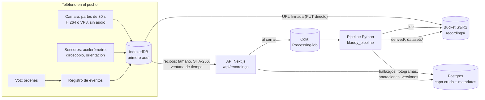
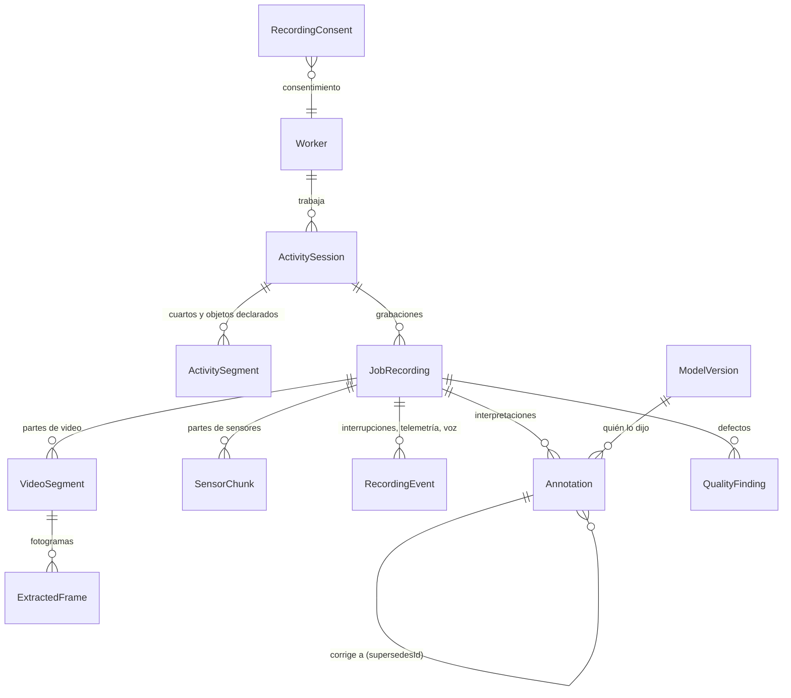
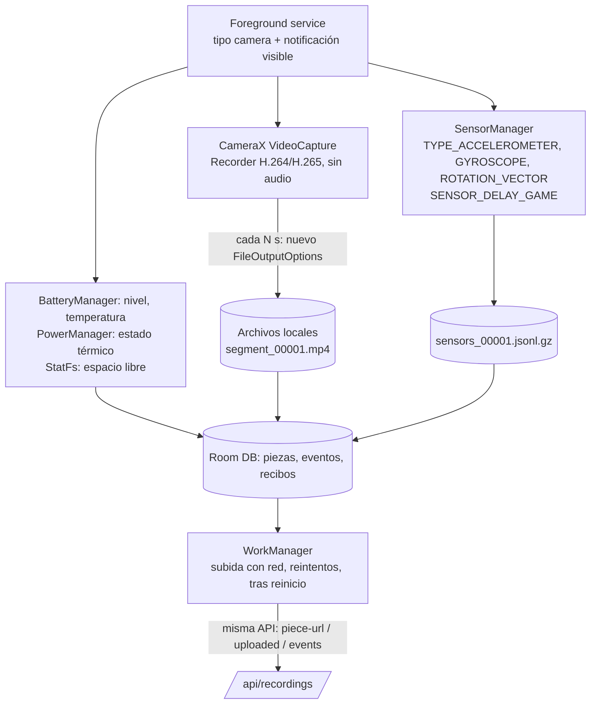
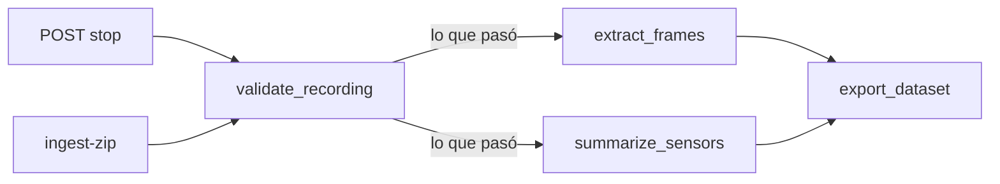

# Datos del trabajo real: captura, conservación y datasets

Este documento responde a la especificación *"data acquisition and storage
architecture for collecting real-world human work demonstrations"* (nov 2026)
punto por punto: los nueve entregables que pide (§1–§9), más calidad del dato
(§10), privacidad (§11) y qué está probado y qué falta (§12).

**Una regla lo ordena todo: lo observado no se toca nunca, y lo que alguien
(o algo) concluye de ello se guarda al lado, con nombre y versión.** El video,
los sensores y el registro de interrupciones son la capa *cruda*; los
fotogramas, los resúmenes y las etiquetas son capas *derivadas* o
*interpretaciones*, y siempre apuntan a lo crudo de donde salieron.

Relación con el resto: `docs/APRENDIZAJE.md` explica para qué se miden los
tiempos (el ritmo de cada persona). Este documento explica cómo se guarda
todo lo que se graba, para poder entrenar con ello dentro de un año sin
preguntarse qué significa cada número.

---

## 0. Para qué sirve, en una página

Para cotizar mejor hay que saber **por qué** un trabajo tardó lo que tardó. El
cronómetro ya da el *cuánto*: la cocina tardó 52 min y el motor predijo 40.
Lo que esta infraestructura añade es el *por qué*, y lo guarda de forma que
se pueda volver a mirar:

- **Video** de lo que se hizo, cortado en partes de 30 s que se reproducen
  solas y llevan su huella digital (SHA-256).
- **Movimiento** del teléfono en el pecho (acelerómetro y giroscopio, ~60 por
  segundo): cuándo la persona estaba restregando y cuándo esperando a que
  actuara un producto.
- **Lo que dijo la persona** ("horno", "baño dos") con su hora exacta: las
  etiquetas vienen de quien hizo el trabajo, en el momento.
- **Todo lo que interrumpió la grabación** (pausa de privacidad, pantalla
  apagada, sin señal, sin espacio), para que un hueco nunca se confunda con
  un trabajo más corto.

Con eso, más adelante, una diferencia de 12 minutos entre lo predicho y lo
real se puede explicar ("el horno tenía grasa quemada: 9 min de restregar
continuo") y convertir en una corrección del modelo de precios. Sin video ni
sensores, solo se ve que tardó más.

**Lo que no hace:** no cambia ningún precio. El precio sigue saliendo de
código determinista (`CLAUDE.md`). Esto es la materia prima para calibrarlo.

---

## 1. Arquitectura del sistema



Cuatro piezas independientes, como pide la especificación:

| Pieza | Qué hace | Dónde |
|---|---|---|
| **Captura** | Graba, guarda en el teléfono, sube, reintenta | `components/pilot/capture.ts`, `HandsFree.tsx`, `recordingStore.ts` |
| **Ingesta** | Firma las subidas, guarda recibos y eventos, consentimiento | `app/api/recordings/route.ts`, `lib/activity/recordings.ts` |
| **Procesado** | Valida, extrae fotogramas, resume sensores, etiqueta | `pipeline/klaudy_pipeline/` |
| **Almacenamiento** | Postgres para metadatos, bucket para bytes | `prisma/schema.prisma`, `lib/storage/s3.ts`, `pipeline/klaudy_pipeline/storage.py` |

Los bytes del video **nunca pasan por el servidor web**: el teléfono los sube
directo al bucket con una URL firmada de 15 minutos. El servidor solo recibe
los recibos. Eso es lo que permite que Replit sirva la app sin cargar con
gigabytes.

---

## 2. Esquema de datos y relaciones



**Capa cruda** (se escribe una vez, no se edita): `JobRecording`,
`VideoSegment`, `SensorChunk`, `RecordingEvent`, `RecordingConsent`, y lo
que declara el limpiador en `ActivitySegment`.

**Capa derivada** (reproducible desde lo crudo, con `pipelineVersion`):
`ExtractedFrame`, el resumen de sensores en Parquet, `QualityFinding`.

**Interpretaciones** (opiniones con autor): `Annotation` + `ModelVersion`.

**Infraestructura**: `ProcessingJob` (cola), `DatasetVersion`,
`DataAccessLog`.

### Las entidades de la especificación, en este esquema

| Especificación | Aquí | Por qué así |
|---|---|---|
| workers | `Worker` | Ya existía (ritmo por persona). |
| recording_sessions | `ActivitySession` + `JobRecording` | Un trabajo puede tener varias grabaciones (se apagó y se volvió a encender). |
| video_segments | `VideoSegment` | Con SHA-256, bytes y ventana monotónica. |
| extracted_frames | `ExtractedFrame` | Con su `ptsMs` exacto y el segmento de origen. |
| sensor_observations | `SensorChunk` + Parquet por segundo | Las muestras no son filas: 3 h a 60 Hz son 650.000 por grabación. |
| rooms, objects, surfaces | Catálogos en código (`ROOM_TYPES`, `OBJECT_TIME_COST`, materiales) + `roomKey` del trabajo | Ya son la fuente de verdad del motor de precios; una tabla duplicada se desincronizaría. |
| task_sessions | `ActivitySegment` | Cada cuarto u objeto marcado, con lo predicho congelado. |
| detected_activities, task_observations, difficulty/effort/quality_annotations | `Annotation` con `kind` = activity, task, difficulty, effort, quality… | Una sola línea de tiempo, consultable entera. Ver §7. |
| model_predictions | `Annotation` con `source = machine` | |
| human_corrections | `Annotation` con `source = human` y `supersedesId` | La predicción corregida no se borra. |
| model_versions | `ModelVersion` | Proveedor, modelo, versión, versión del prompt, configuración y su hash. |
| annotation_versions | La cadena `supersedesId` + `DatasetVersion` | |

Todas las filas tienen identificador estable y referencia temporal (§5 del
documento original): tiempos del servidor en UTC (`startedAt`, `serverAt`) y
tiempos del teléfono en milisegundos monotónicos desde el inicio de la
grabación (`monoStartMs`, `monoMs`, `offsetMs`).

### El tiempo, que es lo que más se rompe

- El teléfono mide con su **reloj monotónico** (`performance.now()`): no salta
  si alguien cambia la hora o la red la corrige a mitad de trabajo.
- Antes de grabar hace 5 viajes al servidor (`GET /api/recordings?clock=1`) y
  se queda con el más rápido: `clockOffsetMs` (servidor − teléfono) con un
  error de la mitad de `clockRttMs`. Cada 10 min repite y lo anota
  (`clock_sync`) para corregir la deriva.
- `JobRecording.startedAt` = el instante 0 del teléfono en hora del servidor.
  Así **inicio de un cuarto − startedAt = dónde empieza ese cuarto en el
  video**: una resta.
- Si el reloj no es fiable, se usa la hora del servidor y se anota
  `clock_untrusted`, en vez de fingir precisión.

---

## 3. Captura en Android

### Lo que funciona hoy: el navegador del teléfono

`components/pilot/capture.ts` y `HandsFree.tsx`, probado con cámara falsa en
Chromium 153 (§12):

- **Partes independientes**: cada 30 s arranca un `MediaRecorder` nuevo sobre
  la misma cámara y el anterior se detiene 300 ms después. Cada parte es un
  archivo completo que se reproduce solo; perder una pierde 30 s, no todo lo
  que viene después (eso pasaba con la primera versión).
- **H.264 en MP4** cuando el navegador lo ofrece (Chrome actual en Android),
  VP8 en WebM si no. 480p, 15 fps, 0,8 Mbit/s; todo configurable por
  variables (`RECORDING_*`).
- **Sin audio.** El micrófono solo se usa para las órdenes, y de lo que oye
  solo se anota lo que fue una orden.
- **Sensores**: `devicemotion` y `deviceorientation` (~60 Hz en Android), en
  JSONL comprimido cada 30 s.
- **Primero en el teléfono**: cada parte se guarda en IndexedDB con su SHA-256
  y CRC-32 y se borra solo cuando el servidor confirmó el recibo.
- **Recuperación**: si la página muere, al abrir el cronómetro otra vez sube lo
  que quedó y cierra la grabación donde terminó su última parte.
- **Eventos**: pantalla oculta, página congelada, sin red, cámara perdida,
  sin espacio, pausa de privacidad, batería, almacenamiento, presión de CPU.
- **Sin nube**: se exporta un ZIP con las partes y un `manifest.json`; el
  pipeline lo importa (`ingest-zip`) como si se hubiera subido.

Límites del navegador que no se arreglan desde el navegador:

| Necesidad | Navegador | Por qué importa |
|---|---|---|
| Grabar con la pantalla apagada o en otra app | **No** | Si el limpiador bloquea el teléfono, se para la cámara. Hoy se mantiene la pantalla encendida (Wake Lock). |
| Seguir tras reiniciar el teléfono | **No** | Se recupera lo guardado, pero la grabación no se reanuda sola. |
| Temperatura del teléfono | **No** (solo presión de CPU en Chrome) | El calor es lo primero que va a fallar en 3 h en una cocina. |
| H.265 | **No** en Chrome | H.264 basta para reconocer tareas. |
| Fiabilidad de 3–4 h | **Sin medir** | La especificación lo dice bien: no se asume sin probar en un teléfono. |

### El diseño nativo (no construido)

Para grabaciones largas del equipo, la app nativa de Android es lo correcto, y
el diseño encaja con todo lo de arriba **sin cambiar ni una tabla ni una
ruta**: la app nativa habla con la misma API y sube al mismo bucket con los
mismos nombres. No está construida porque aquí no hay SDK de Android ni un
teléfono donde probarla, y una app de grabación de 3 h no se da por buena sin
probarla en el teléfono real.



Decisiones del diseño nativo:

1. **Foreground service** (`foregroundServiceType="camera"`): Android lo exige
   para usar la cámara sin la app delante, y obliga a una notificación
   visible — que además es el "control visible de grabación" que pide la
   especificación.
2. **Partes rotativas con CameraX**: se detiene una `Recording` y se empieza
   otra con un `FileOutputOptions` nuevo cada N segundos. CameraX no solapa
   dos grabaciones; el hueco entre partes (decenas de ms) se mide y queda en
   las ventanas `monoStartMs/monoEndMs`.
3. **Relojes**: `SystemClock.elapsedRealtimeNanos()` es el monotónico (sigue
   contando dormido) y los `SensorEvent.timestamp` están en esa misma base.
   Los fotogramas de la cámara **suelen** estarlo (fuente de tiempo
   `REALTIME`), pero depende del teléfono: la app lee
   `SENSOR_INFO_TIMESTAMP_SOURCE` y lo anota, para que nadie alinee video y
   sensores dando por hecho algo que ese teléfono no cumple.
4. **Room** guarda cada pieza y evento antes de subir; **WorkManager** sube con
   red disponible, reintenta con espera creciente y sobrevive a reinicios.
5. **Telemetría**: batería (`EXTRA_TEMPERATURE` incluida), estado térmico
   (`PowerManager.getCurrentThermalStatus`), espacio libre; al llegar a
   "severo" se baja a 10 fps y se anota, en vez de que el sistema mate la app.
6. **Tras reinicio**: `BOOT_COMPLETED` reanuda las subidas pendientes; la
   grabación **no** se reanuda sola (sería grabar sin que nadie lo sepa).

Esfuerzo estimado: un desarrollador Android, 4–6 semanas hasta una versión de
prueba, más el tiempo de probarla con limpiadores reales.

---

## 4. Servicios del backend

`app/api/recordings/route.ts`. La identidad sale siempre de la cookie, nunca
del cuerpo: un recibo que cualquiera pudiera firmar con el nombre de otro no
valdría nada.

| Llamada | Qué hace |
|---|---|
| `GET ?clock=1` | La hora del servidor, sin nada más (para que el viaje sea corto). |
| `GET` | Configuración de captura, si hay bucket, y si esta persona ya aceptó. |
| `POST start` | Exige los dos consentimientos; fija `startedAt` con la corrección de reloj; guarda cámara y teléfono. |
| `POST piece-url` | URL firmada para subir **una** pieza (video o sensores). |
| `POST uploaded` | El recibo: bytes, SHA-256, ventana. Se escribe una vez; un recibo repetido que no coincide se anota (`piece_conflict`), no se aplica. |
| `POST events` | Hasta 200 eventos; idempotente por número de secuencia. |
| `POST stop` | Cierra (donde acabó la última pieza si viene de una recuperación) y pone en cola la validación. |

Una grabación pertenece a quien registró el trabajo, también después de
cerrado: así se pueden subir las piezas que dejó una página muerta.

Sin base de datos todo funciona en memoria, como el resto de la app; sin
bucket el video se queda en el teléfono. **Todo se integra apagado.**

---

## 5. Almacenamiento

Un solo bucket S3 compatible (Cloudflare R2 recomendado: sin coste de
salida), tres prefijos que no se mezclan:

```
recordings/<sesión>/<grabación>/video/00001.mp4        ← crudo, lo sube el teléfono
recordings/<sesión>/<grabación>/sensors/00001.jsonl.gz ← crudo
derived/<grabación>/frames/<versión>/<método>/00001/00001049.jpg
derived/<grabación>/sensors/<versión>/per_second.parquet
datasets/<nombre>/v<N>/recordings.parquet … manifest.json
```

- **Lo crudo no se reescribe.** El pipeline tiene prohibido escribir bajo
  `recordings/` (`RawWriteRefused`); la única excepción es importar un ZIP,
  y solo bytes cuyo SHA-256 coincide con el del teléfono.
- **Lo derivado se puede borrar y regenerar** desde lo crudo. Por eso está
  todo bajo `derived/<grabación>/`: borrar una grabación es borrar dos
  prefijos.
- **Cifrado**: en tránsito, HTTPS obligatorio (la configuración rechaza
  `http://`); en reposo, R2 y S3 cifran todos los objetos por defecto.
- **Acceso**: el bucket es privado; el teléfono solo recibe URLs de una pieza
  y 15 minutos. Exportar, importar y borrar quedan en `DataAccessLog`.
- **Retención**: `purge --older-than-days N` — una orden explícita que sin
  `--apply` solo dice qué borraría. Nada se borra solo.

---

## 6. Pipeline de procesamiento

`pipeline/klaudy_pipeline/`, Python 3.11, ffmpeg/ffprobe, Postgres y el
bucket. Se ejecuta como `python -m klaudy_pipeline …` (SETUP.md, Paso 13).



| Trabajo | Qué hace | Escribe |
|---|---|---|
| `validate_recording` | Descarga cada pieza y comprueba su SHA-256; decodifica cada parte entera; busca huecos y los explica con el registro; revisa sensores, reloj, duplicados y las marcas del limpiador. | `QualityFinding` |
| `extract_frames` | Un fotograma por segundo (`uniform`) y los fotogramas donde cambia la escena (`scene`), cada uno con su `ptsMs` exacto del original. Salta las partes rechazadas. | `ExtractedFrame` + JPEG |
| `summarize_sensors` | Resumen por segundo (aceleración, giro, inclinación) y una primera opinión "quieto / en movimiento" por tramos de 5 s. | Parquet + `Annotation` (máquina) |
| `export_dataset` | Instantánea versionada (§8). | Archivos + `DatasetVersion` |

La cola es la tabla `ProcessingJob` con `FOR UPDATE SKIP LOCKED`: dos
trabajadores nunca toman el mismo trabajo, y un fallo vuelve a la cola con
espera creciente (1, 2, 4, 8 min) hasta 5 intentos. Es el "Redis o
equivalente" de la especificación sin un servicio más (§9).

**Lo que la especificación pide y aún no hace el pipeline**: reconocimiento
de actividades y objetos con un modelo, segmentación de acciones y
preprocesado de imagen (por ejemplo, difuminar caras). El sitio para cada uno
ya existe: un trabajo más en la cola que lee `ExtractedFrame` y escribe
`Annotation` con su `ModelVersion`. El primero lógico es pasar los fotogramas
por el mismo modelo de visión que ya cotiza, con un prompt que solo nombre la
actividad y el objeto ("restregando · horno"); cuesta dinero por fotograma, así
que va apagado sin clave como todo lo demás.

---

## 7. Anotación

Una sola tabla, `Annotation`, para todo lo que alguien concluye: actividad,
acción, tarea, objeto, superficie, dificultad, esfuerzo, calidad. Lleva todos
los campos de la especificación: tipo y etiqueta, inicio y fin (en ms de la
grabación y en hora del servidor), tiempo activo y de espera, repeticiones,
objeto, superficie, cuarto, herramientas, condiciones, indicadores
(`attributes`), fotogramas en los que se apoya (`frameRefs`), confianza,
fuente y estado de revisión.

**Tres fuentes, nunca mezcladas** (`source`):

- `machine`: un modelo o una regla. Siempre con `modelVersionId`.
- `worker`: lo que declaró quien trabajaba. Las marcas en vivo (voz, botones)
  se quedan donde se registraron, en `ActivitySegment`, y los datasets las
  presentan como `source: worker`.
- `human`: alguien que revisó. Con `annotatorId`.

**Corregir no es editar.** Si una persona dice que el tramo "quieto" en
realidad era restregar, se escribe una fila nueva (`source: human`,
`supersedesId` → la de la máquina). Las dos sobreviven, así que "¿cuántas
veces se equivoca la regla?" es una consulta, no una discusión. Está probado
en `pipeline/tests/test_derived.py`.

Una tabla en vez de una por tipo: una sola línea de tiempo por grabación, y
añadir un tipo nuevo ("¿usó guantes?") no exige migrar el esquema. A gran
escala se particiona por mes (§9).

---

## 8. Versionado de datasets

`python -m klaudy_pipeline export work-demos` escribe
`datasets/work-demos/v<N>/` con un JSONL y un Parquet por tabla
(grabaciones, partes, sensores, eventos, marcas del limpiador colocadas en el
tiempo del video, anotaciones con su modelo, fotogramas, hallazgos,
consentimientos) y un `manifest.json` con el SHA-256 de cada archivo, los
filtros, la versión del pipeline y la del código.

- **Inmutable**: la siguiente exportación es v<N+1>; v<N> no se toca.
- **Reproducible**: los mismos datos dan los mismos bytes (probado).
- **Trazable**: cada anotación lleva proveedor, modelo, versión, versión del
  prompt y configuración; cada fotograma, su parte y su `ptsMs`.
- **Solo lo que se puede usar**: trabajos reales (no `test`), con los dos
  consentimientos vigentes y, por defecto, sin hallazgos de error abiertos.
- **Sin datos personales**: ni correos ni nombres; las personas aparecen como
  su `workerId`.
- El video **no se copia**: cada fila lleva `objectKey` y `sha256`, que dicen
  exactamente qué bytes son.

---

## 9. Infraestructura y escala

**Hoy (piloto)**: la app en Replit, Postgres de Replit, un bucket R2, y el
pipeline como tarea programada de Replit (`run --once` cada pocos minutos,
`sweep` cada hora). Sin servicios nuevos que mantener.

**Cuentas para 1.000 limpiadores**, una grabación de 3 h al día cada uno:

| | Por grabación | Por día (1.000) | Por año |
|---|---|---|---|
| Video a 0,8 Mbit/s (tope) | ~1,1 GB | ~1,1 TB | ~400 TB |
| Sensores | ~12 MB | ~12 GB | ~4 TB |
| Fotogramas a 1/s | ~10.800 × 30–50 KB | — | — |
| Filas de partes + sensores + eventos | ~1.000 | ~1 M | ~365 M |

Lo que eso significa:

1. **El almacenamiento es barato; etiquetar es caro.** 400 TB en R2 son del
   orden de 6.000 $/mes al final del primer año (a precio de lista de hoy,
   verificar), y menos moviendo lo viejo a almacenamiento infrecuente. Una
   hora de video revisada por una persona cuesta mucho más. Por eso las
   etiquetas del propio limpiador (su voz) valen tanto: son gratis y
   llegan en el momento.
2. **Los fotogramas a 1 por segundo no escalan como filas**: 10.800 por
   grabación son 4.000 millones de filas al año. A esa escala, los fotogramas
   uniformes bajan a 1 cada 5 s más los de cambio de escena, y su índice pasa
   a Parquet en el bucket (Postgres guarda uno por grabación). Como son
   derivados, se regeneran desde el video cuando se necesiten.
3. **La cola en Postgres aguanta miles de trabajos al día.** Con millones al
   día, o varios equipos de procesado, se pasa a Redis o SQS: solo cambia
   `queue.py`, los trabajos son los mismos.
4. **Procesado**: decodificar 3 h a 480p con ffmpeg lleva del orden de 1–3 min
   por CPU. 1.000 grabaciones al día son unas decenas de horas de CPU: unos
   pocos trabajadores, no un clúster.
5. **Postgres**: `RecordingEvent` y `Annotation` se particionan por mes cuando
   pasen de ~100 M filas; los índices ya están por `recordingId`.

---

## 10. Calidad del dato

El pipeline **nombra** los defectos y no inventa lo que falta
(`pipeline/klaudy_pipeline/findings.py`, lista completa):

| Lo que pide la especificación | Hallazgo |
|---|---|
| Partes que faltan | `missing_segment`, `missing_object` |
| Video corrupto | `corrupt_video`, `checksum_mismatch` |
| Tiempos que faltan | `missing_timestamps`, `clock_untrusted`, `clock_drift` |
| Grabaciones duplicadas | `duplicate_recording`, `piece_conflict` |
| Sensores desincronizados | `sensor_mismatch`, `sensor_gap` |
| Anotaciones que faltan | `missing_annotations` (la cámara grabó y nadie marcó nada) |
| Límites de tarea incoherentes | `inconsistent_task_boundaries` (dos cuartos a la vez sin "juntos") |
| Predicciones de baja confianza | Columna `confidence` + `reviewStatus`: la cola de revisión es una consulta, no un hallazgo |
| Sesiones incompletas | `incomplete_session` (nunca se detuvo; lo encuentra `sweep`) |
| Huecos | `video_gap`: `info` si lo explica una pausa de privacidad, `warning` si nada lo explica |

Un hallazgo se **resuelve** (`resolvedAt`), no se borra. Validar dos veces no
duplica nada.

---

## 11. Privacidad y seguridad

El dueño decidió dejar lo legal para después de la ronda (24 nov). Lo que hay
aquí es la **fontanería técnica** sin la cual ningún dataset se podría usar
nunca, aunque luego un abogado reescriba las palabras:

- **Dos consentimientos antes del primer fotograma**: el del limpiador (una vez
  por versión del texto) y el del cliente (cada trabajo, lo confirma el
  limpiador en la puerta). La API rechaza grabar sin los dos. Texto y versión
  en `lib/activity/recordings.ts`; **pendiente de revisión legal**.
- **Control visible**: el indicador rojo de "Grabando" y el botón *Pausar
  cámara*, que deja constancia de la pausa.
- **Sin conversaciones**: no se graba audio; de la voz solo se anotan las
  órdenes.
- **Borrado**: `delete-recording` borra bytes, derivados y filas y lo anota;
  `withdraw-consent` saca a una persona de los datasets siguientes.
- **Registro de accesos**: exportar, importar, borrar y retirar
  consentimiento quedan en `DataAccessLog`.
- **Pendiente**: difuminar caras y pantallas en los fotogramas antes de que
  los vea un etiquetador; el consentimiento de terceros (otras personas en la
  casa) más allá de la pausa; y la revisión legal del texto.

---

## 12. Qué está probado y qué falta

**Probado aquí** (cámara falsa de Chromium 153, sensores simulados, bucket
falso, Postgres real):

- 4 partes de 10 s subidas; **cada una se reproduce sola** sin errores, en
  H.264 (MP4) y en VP8 (WebM); el SHA-256 de lo que llegó coincide con el
  recibo en las 8 piezas; las muestras de sensores coinciden en número y
  caen dentro de su ventana.
- Reloj: corrección de 0,8 ms con un viaje de 6 ms (mismo ordenador).
- Pausa de privacidad: el hueco queda explicado por el evento y la validación
  lo marca como esperado.
- Página muerta sin señal: las piezas esperaron en el teléfono, se subieron al
  volver, y la grabación se cerró donde acabó la última pieza guardada. Se
  perdió solo la parte que se estaba grabando, como estaba previsto.
- Sin bucket: el ZIP lo abren las herramientas estándar, el pipeline lo
  importa sin duplicar eventos, y valida, extrae y resume igual que una subida.
- Pruebas: `tests/recordings.test.ts` (16), `pipeline/tests/` (30).

**Falta, y no se puede probar sin un teléfono de verdad**:

- Batería y calor en 3 h con la cámara encendida (los 480p/15 fps/0,8 Mbit/s
  son un punto de partida, no una medida).
- Si dos `MediaRecorder` a la vez en el corte pesan en un teléfono barato.
- Si `devicemotion` sigue a 60 Hz con la cámara grabando.
- La app nativa (§3).

**Falta construir**: reconocimiento de actividades con modelo, difuminado de
caras, la pantalla de revisión para que una persona corrija etiquetas.
